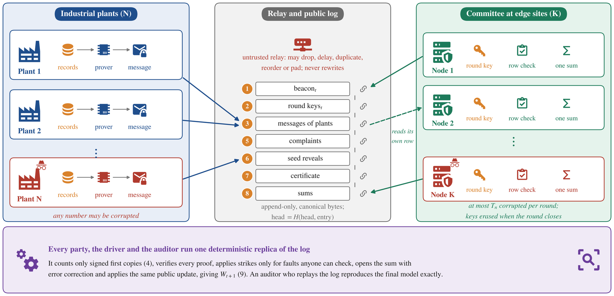

# FedProof

Federated intrusion detection for industrial networks in which no party has to be trusted.

Each plant sends its model update together with a zero-knowledge proof that the update is exactly one step of training
on data the plant committed to in advance, with per-record clipping and differential-privacy noise it cannot bias. The
update itself is never seen: it travels as packed secret shares encrypted under post-quantum keys, and a committee of
nodes opens only the sum over a certified set of plants. Every party, including the relay that carries the traffic,
acts only on a public log, so anyone can replay the log and obtain the same model.

This repository contains the reference implementation and every experiment of the paper

> T. M. T. A. Ibrahim, H. M. Attaullah, J. Abdullah and M. M. Su'ud, "FedProof: Zero-Trust Post-Quantum Federated
> Intrusion Detection for Industrial IoT via Proof-Carrying Training," under review.



## Contents

| Folder | What it holds |
|---|---|
| `fedproof/` | The system: Goldilocks field arithmetic, the hash-based zero-knowledge argument, the exact integer training step, packed secret sharing, ML-KEM-768 and ML-DSA-65, the log-driven protocol and the privacy accountant |
| `experiments/` | Dataset preparation and experiments E1 to E9 |
| `tests/` | 23 test files: honest runs, cheating provers and 60 protocol attack scenarios |
| `results/` | The raw result files behind every number in the paper |
| `figures/` | Scripts that draw the figures of the paper |
| `docs/` | Protocol specification and security proofs |

## Installation

Python 3.11 or later on Linux. macOS works for everything except the kernel-shaped network runs.

```bash
git clone <repository URL> fedproof
cd fedproof
python3 -m venv .venv
source .venv/bin/activate
pip install -r requirements.txt
```

A C compiler is optional. If `gcc` is available, `fedproof/gl.c` is compiled on first use and field arithmetic runs
about 15 times faster. Installing `pqcrypto` speeds up signatures and key exchange; results are checked to be identical
to the pure-Python path.

## Running the tests

```bash
python tests/run_all.py
```

This runs every test file and writes a summary to `runs/tests_summary.txt`. It takes about ten minutes on a 12-thread
laptop.

## Reproducing the paper

1. Download the three datasets and put the CSV files in `data/raw/`:

   | Dataset | File | Source |
   |---|---|---|
   | Edge-IIoTset | `DNN-EdgeIIoT-dataset.csv` | [IEEE DataPort](https://ieee-dataport.org/documents/edge-iiotset-new-comprehensive-realistic-cyber-security-dataset-iot-and-iiot-applications) |
   | WUSTL-IIoT-2021 | `wustl_iiot_2021.csv` | [IEEE DataPort](https://ieee-dataport.org/documents/wustl-iiot-2021) |
   | X-IIoTID | `X-IIoTID dataset.csv` | [IEEE DataPort](https://ieee-dataport.org/documents/x-iiotid-connectivity-and-device-agnostic-intrusion-dataset-industrial-internet-things) |

2. Prepare the data and run the experiments:

   ```bash
   python experiments/run.py prepare
   python experiments/run.py all
   ```

   Results are written to `runs/`. The run can be stopped and restarted at any time; finished rows are skipped. The
   whole suite takes several hours on a laptop, about three of them for E8. Single experiments run with, for example,
   `python experiments/run.py E2 E4`, and `--quick` checks that everything works in a few minutes.

3. Optionally, repeat E6 on links shaped by the Linux kernel (needs root):

   ```bash
   sudo -E FEDPROOF_ROUTER_BIND=0.0.0.0 .venv/bin/python experiments/run.py E6 --netns
   ```

4. Draw the tables and figures:

   ```bash
   python experiments/run.py report --results runs
   python figures/make_figures.py runs
   ```

   Use `results` instead of `runs` to draw them from the result files of the paper.

| Experiment | In the paper |
|---|---|
| E1 detection without privacy noise | Table II |
| E2 detection against the privacy budget | Fig. 5 |
| E3 integrity test suite | Section VI |
| E4 poisoning | Fig. 6 |
| E5 cost of one proof-carrying message | Table III, Fig. 7 |
| E6 round time on industrial links | Fig. 8 |
| E7 scaling to 100 plants | Fig. 9 |
| E8 end-to-end training with real proofs and audit | Table IV |
| E9 membership inference | Section VI |

## License

The code is released under the MIT License. The datasets are not included; they belong to their authors and are
distributed under their own terms. The icons in `figures/icons/` are from Material Design Icons by Pictogrammers,
under the Apache License 2.0.
